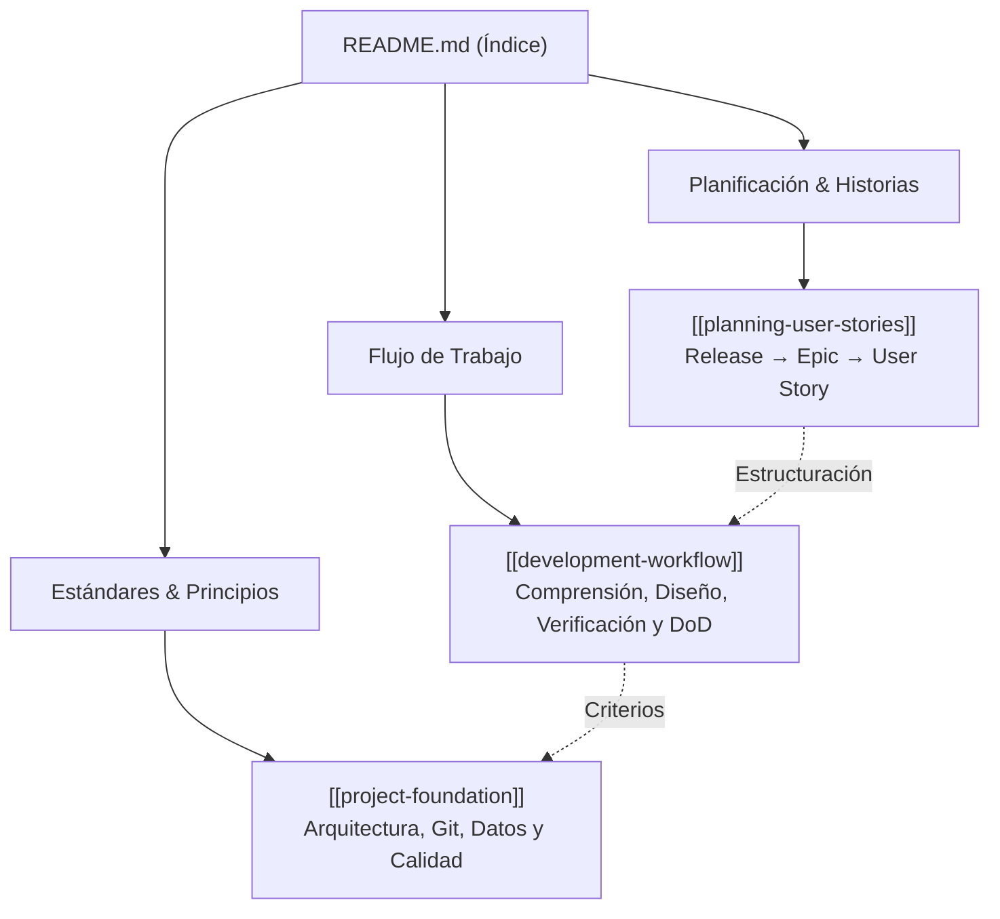

# Metodología de desarrollo asistido por IA

Bienvenido al repositorio de **Metodología de desarrollo asistido por IA**. Este repositorio contiene normas, estándares y flujos de trabajo reutilizables para guiar a agentes de IA y desarrolladores en cualquier proyecto de software.

Está estructurado para funcionar como:
1. Documentación metodológica versionada en Git.
2. Vault navegable mediante **Obsidian** (usando `[[wikilinks]]`).
3. Base de conocimiento para **Graphify**.
4. Contexto explícito para **Agentes de IA** de navegación y descubrimiento progresivo.

---

## 🗺️ Mapa Navegable de la Metodología

---

## 📚 Documentos y Secciones

1. **[[project-foundation]] (Estándares de arquitectura, Git, datos y calidad)**:
   Define los principios transversales (**Clean Architecture**, **SOLID**, **DDD**, **DRY**, **KISS**, **YAGNI**), convenciones de ramas Git, migraciones de base de datos y diseño de APIs.

2. **[[development-workflow]] (Flujo de trabajo para implementación de tareas)**:
   Describe las 7 etapas obligatorias para abordar una tarea (Comprensión → Diseño → Implementación → Estado ejecutable → Verificación → Documentación → Git), los criterios del **Definition of Done** y el principio rector.

3. **[[planning-user-stories]] (Organización de historias de usuario)**:
   Especifica la jerarquía de planificación (**Release → Epic → User Story**), la estructura de los criterios de aceptación y las reglas para desglosar tareas técnicas.

