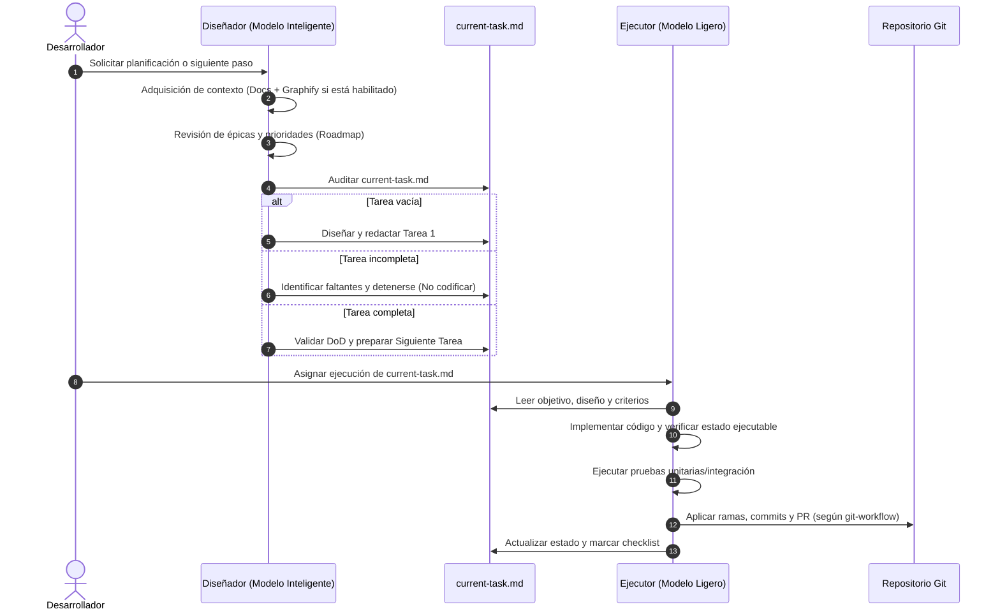

# Flujo de trabajo y coordinación: Diseñador y Ejecutor

**Propósito:** Definir el modelo de trabajo desacoplado entre dos roles complementarios de IA: el **Diseñador/Planificador** (modelo reflexivo/inteligente) y el **Ejecutor** (modelo ligero/operativo), coordinados a través del documento de relevo configurado en `workflow.current_task.path` (por defecto `current-task.md`).

Las rutas de conocimiento, planificación, grafo y tarea actual se leen de `ai-methodology.config.json`. No asumir la estructura de un proyecto concreto.

Para conocer los principios de arquitectura y calidad, consultar [[project-foundation]]. Para las pautas operativas de Git, consultar [[git-workflow]].

---

## 1. Definición de roles y responsabilidades

### Rol 1: Diseñador / Planificador (Modelo Inteligente)
Actúa como arquitecto y estratega del proyecto. Sus funciones son:
* **Recuperación de contexto:** Consulta la fuente de conocimiento indicada en `knowledge.source.path`, utilizando **Graphify** (`graphify query`, `graphify path`, `graphify explain`) cuando `knowledge.graph.enabled` es `true`.
* **Priorización desde las épicas:** Revisa el backlog y las épicas (`planning.epics.path` relativo a la fuente de conocimiento) para determinar qué corresponde desarrollar según dependencias y prioridades del roadmap (`planning.roadmap.path`).
* **Inmutabilidad de épicas:** **Nunca modifica las épicas**. Las épicas representan los requerimientos estables del producto y no se alteran durante el ciclo de planificación de tareas.
* **Gestión de la tarea actual:** Utiliza el archivo de `workflow.current_task.path` como documento vivo de trabajo:
  * *Si está vacío:* Define, diseña y redacta la primera tarea técnica ejecutable.
  * *Si está incompleto:* Analiza el progreso respecto a los criterios de aceptación, identifica los faltantes y **no genera código**.
  * *Si está completo:* Valida el cumplimiento del *Definition of Done*, cierra la tarea y prepara la siguiente.
* **Límite de responsabilidad:** El Diseñador no escribe código fuente, no ejecuta pruebas ni realiza commits. Su producto es la tarea cerrada y documentada.

### Rol 2: Ejecutor (Modelo Ligero)
Actúa como constructor enfocado en la entrega técnica. Sus funciones son:
* **Ejecución disciplinada:** Toma el archivo de tarea actual como contrato cerrado e implementa la solución siguiendo los principios de [[project-foundation]].
* **Estado ejecutable y pruebas:** Garantiza que el código compile limpiamente, no rompa dependencias y supere todas las validaciones necesarias.
* **Control de versiones:** Gestiona ramas, commits atómicos y Pull Requests siguiendo rigurosamente las pautas de [[git-workflow]].
* **Actualización del estado:** Marca los ítems completados en la tarea actual y reporta cualquier anomalía o bloqueo técnico encontrado.
* **Límite de responsabilidad:** No amplía el alcance de la tarea ni asume decisiones arquitectónicas fuera de lo diseñado.

---

## 2. Flujo obligatorio por etapas

### Fase de Planificación (Diseñador)

#### 1. Comprensión
Antes de preparar una tarea, el Diseñador debe:
* Localizar la documentación relevante y navegar relaciones arquitectónicas mediante Graphify cuando esté habilitado.
* Identificar módulos, dependencias y restricciones conocidas del proyecto.
* Detectar inconsistencias, ambigüedades o riesgos potenciales en los requisitos.

#### 2. Diseño y Preparación (tarea actual)
El Diseñador toma el ítem prioritario del **Checklist de ejecución de la épica** y lo formula dentro del archivo de tarea actual, donde reside la Historia de Usuario para la tarea:
* **Origen:** Referencia a la épica e ítem de origen (sin modificar la épica).
* **Historia de Usuario:** Enunciado formal (*Como... quiero... para...*).
* **Criterios de Aceptación:** Condiciones objetivas y verificables del comportamiento esperado.
* **Diseño Técnico:** Componentes específicos a modificar/crear, interfaces, contratos de datos y arquitectura aplicable.
* **Checklist de Ejecución:** Tareas discretas que el Ejecutor debe implementar y marcar.
* **Estrategia de Verificación:** Pruebas unitarias/integración exactas y comandos de validación.
* **Git:** Nombre de rama y tipo de commit sugeridos conforme a [[git-workflow]].

---

### Fase de Ejecución (Ejecutor)

#### 3. Implementación
Durante el desarrollo, el Ejecutor debe:
* Respetar las convenciones y directivas arquitectónicas de [[project-foundation]].
* Mantener separación de responsabilidades y evitar sobreingeniería o abstracciones prematuras.
* Mantenerse estrictamente dentro del alcance fijado en la tarea actual.

#### 4. Estado ejecutable
El Ejecutor debe evitar dejar deliberadamente:
* Código que no compile o presente errores de sintaxis.
* Dependencias rotas, imports no resueltos o referencias a componentes inexistentes.
* Flujos incompletos que bloqueen el arranque o funcionamiento de la solución.

#### 5. Verificación
El Ejecutor debe ejecutar las validaciones técnicas proporcionales al cambio:
* Compilación limpia.
* Pruebas unitarias y de integración aplicables.
* Verificación de que no se introducen regresiones en funcionalidades existentes.

#### 6. Documentación técnica
* Actualizar documentación técnica, esquemas o comentarios de código cuando el cambio modifique información que deba mantenerse documentada.

#### 7. Control de versiones (Git)
* Crear la rama de trabajo, estructurar commits atómicos y preparar el Pull Request siguiendo íntegramente las directivas de [[git-workflow]].

---

## 3. Definition of Done (DoD)

Una tarea definida en el archivo de relevo se considera terminada cuando:
1. El objetivo funcional especificado fue implementado en su totalidad.
2. Los cambios se mantienen estrictamente dentro del alcance acordado.
3. El proyecto se encuentra en un estado coherente, compila y es ejecutable.
4. Las pruebas y verificaciones fueron ejecutadas y pasaron con éxito.
5. Se respetan los principios de diseño y calidad establecidos en [[project-foundation]].
6. La documentación técnica fue actualizada si el cambio lo requería.
7. Los cambios están organizados en su rama correspondiente con commits convencionales según [[git-workflow]].
8. El checklist de la tarea actual se encuentra totalmente marcado y verificado.

---

## 4. Tamaño y descomposición de tareas

Cada tarea debe ser lo bastante acotada como para ser implementada y verificada de forma controlada por el Ejecutor en un único ciclo de trabajo.

Cuando el Diseñador detecte que una necesidad:
* Abarca múltiples responsabilidades no cohesivas;
* Afecta demasiados componentes sin relación directa;
* Requiere romper temporalmente el estado funcional del proyecto;
debe descomponer el trabajo en tareas consecutivas más pequeñas, preparando únicamente la tarea inmediata.

---

## 5. Principio rector

**El Diseñador comprende el contexto y delimita la tarea sin implementar código; el Ejecutor construye, verifica y gestiona el control de versiones sin salir del alcance definido.**
